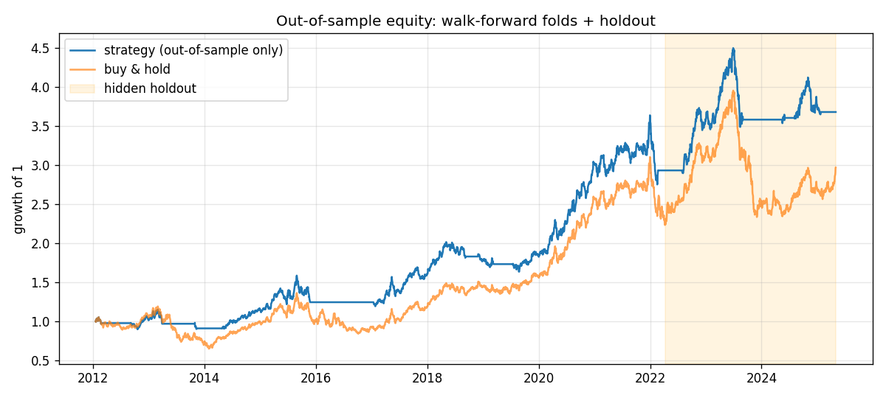

# Quant Research Agent - Run Report

- **LLM:** mock / claude-sonnet-5-5
- **Data:** synthetic (^NSEI), research data up to 2022-04-07, last 20% hidden as holdout
- **Steps used:** 10, **LLM calls:** 11, **time:** 6.1s

## Result: submitted `trend_filter v1`

**Agent summary:** Long-only trend filter; reduces drawdowns by sitting out down regimes.

### One-time holdout evaluation

| metric | strategy | buy & hold |
|---|---|---|
| sharpe | 0.64 | 0.584 |
| cagr | 0.0741 | 0.0936 |
| ann_vol | 0.1236 | 0.1814 |
| max_drawdown | -0.2243 | -0.4091 |
| total_return | 0.2546 | 0.3286 |

Trades: 6, exposure: 0.527, params used: `{'fast': 50, 'slow': 150}`
Deflated Sharpe at submission: {'dsr': 0.9941, 'psr_vs_zero': 0.9941, 'n_trials': 1, 'sharpe_hurdle_annual': 0.0}



### Final strategy code

```python
"""trend_filter v1
Hypothesis: Markets move in persistent regimes; being long only in uptrends (fast MA above slow MA) avoids most of the high-volatility down regimes.
"""
import numpy as np
import pandas as pd

PARAMS = {"fast": 20, "slow": 150}
PARAM_GRID = {"fast": [10, 20, 50], "slow": [100, 150, 200]}

def generate_signals(df: pd.DataFrame, params: dict) -> pd.Series:
    close = df["close"]
    fast = close.rolling(params["fast"]).mean()
    slow = close.rolling(params["slow"]).mean()
    signal = (fast > slow).astype(float)          # long in uptrends, flat otherwise
    return signal.where(slow.notna(), 0.0)
```

## All strategy versions tried

```
strategy | hypothesis | backtest SR | lookahead | WF OOS SR | DSR | critic
momentum_z v1 | Medium-term momentum persists due to investor under-reaction. | - | FAIL | - | - | -
trend_filter v1 | Markets move in persistent regimes; being long only in uptrends (fast ... | 0.916 | pass | 0.774 | 0.9941 | pass
```

**Critic on trend_filter v1: pass**

- (mock critic) Long-only filter can lag sharp reversals; parameters chosen from a small grid.

---
Full step-by-step reasoning: `transcript.md`. Strategy files: `strategies/`.